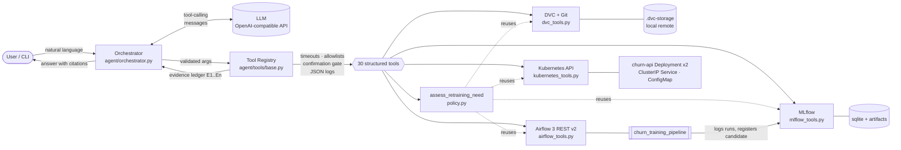
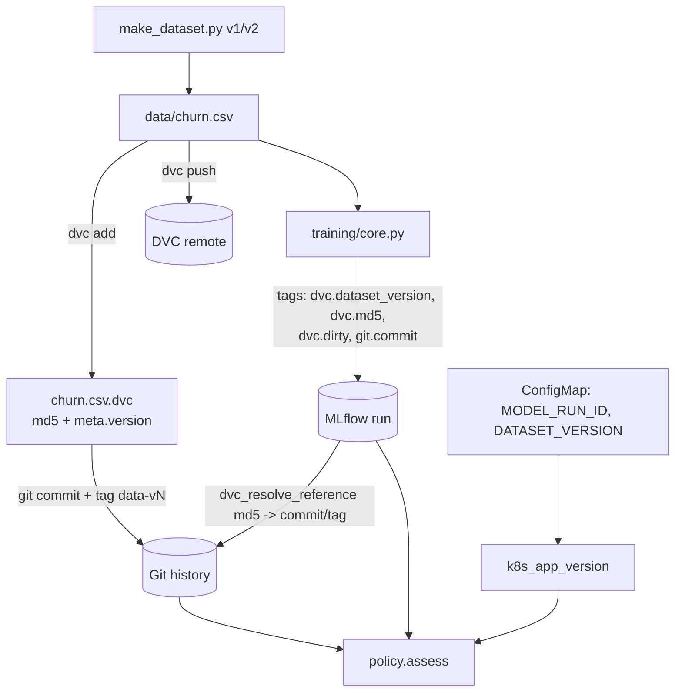
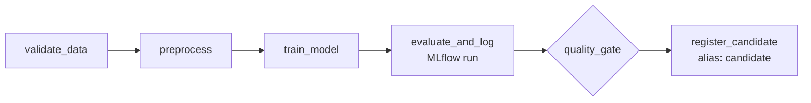

# Architecture

## 1. System overview

The model never talks to a backend directly. Every operational fact enters the conversation as a
`ToolResult` (status, data, error, duration, request id, evidence id) produced by the registry.

## 2. Request lifecycle

1. The CLI sends the user message to the **Orchestrator** with a short system prompt (grounding rules).
2. The LLM returns tool calls (native function calling). Each call is validated against a Pydantic schema
   (`extra="forbid"`), executed with a per-tool timeout, and logged as one JSON line.
3. The result is appended to the conversation as a compact JSON tool message tagged `E<n>`.
4. The loop ends when the model answers without tool calls (max 10 steps).
5. The orchestrator checks that every `[E<n>]` citation exists in the ledger; invented ids are flagged with a
   `[GROUNDING WARNING]`.
6. Output sections: **Known facts / Uncertainties / Recommended actions**.

## 3. Safety architecture

| Control | Where | Effect |
|---|---|---|
| Structured, typed inputs | `schemas.py` | Malformed or extra arguments -> `invalid_request`, tool never runs |
| Per-tool timeouts | `ToolRegistry.execute` | Hung backend -> `timeout` status, agent reports UNKNOWN |
| Write gating | `ToolRegistry` (`access="write"`) | LLM can only *request*; returns `confirmation_required`. Only the human CLI command `/confirm <id>` executes (single-use, 5 min TTL). There is no `confirm` tool the model could call. |
| Namespace allowlist | `kubernetes_tools._ns` | Reads and writes outside `mlops-agent` -> `rejected` *before* any API call or confirmation prompt |
| Bounded scale | `guard_scale` | replicas > 5 rejected |
| Approved DAGs | `airflow_tools._approved` | Only `churn_training_pipeline` can be triggered |
| Command allowlist | `dvc_tools.run_dvc/run_git` | No shell; only `status/diff/get/list/data/version` (dvc) and read-only git sub-commands; revs validated against option injection; dataset paths allowlisted |
| Non-destructive checkout | `dvc_explain_reproduce(verify=true)` | `dvc get` into `.agent-sandbox/`, working tree untouched |
| No automatic retraining | `policy.py`, system prompt | `retraining_started` is always `false`; recommendation requires an explicit trigger |
| Secret hygiene | `logging_utils.py` | Passwords, JWTs, API keys redacted from logs, pod logs and transcripts; credentials only via env vars |
| Evidence grounding | `orchestrator.check_citations` | Citations must resolve to real tool results |

## 4. Retraining policy (`agent/policy.py`)

Pure function over collected evidence. Retraining is **recommended only** if at least one trigger is met:

* **Model freshness**: deployed model older than `AGENT_MAX_MODEL_AGE_DAYS` (default 30).
* **Data freshness**: deployed model's dataset version != current DVC dataset version.
* **Failed quality gate** in the latest Airflow run.
* **User-supplied degradation evidence** (never invented by the agent).

A better F1 elsewhere, or an unhealthy deployment, is *not* a trigger. Missing evidence yields
`insufficient_evidence` and lists the unavailable tools under *Uncertainties*.

## 5. Data and provenance flow

Every run records the dataset md5, its DVC version label, whether the working file differed from the committed
`.dvc` pointer (`dvc.dirty`), and the Git commit of the code. The agent resolves an md5 back to a commit and tag
by walking the history of the `.dvc` file, then proves reproducibility by exporting that revision into a sandbox
and comparing md5s.

## 6. Airflow training DAG

* `retries=2`, `retry_delay=10s` for transient errors; validation and gate failures raise `AirflowFailException`
  (no retries, no wasted compute).
* `register_candidate` runs only if `quality_gate` succeeded - a failed gate leaves it `upstream_failed`.
* Even success only sets the `candidate` alias; promotion to `production` stays manual.
* Params (`data_path`, `algorithm`, `min_f1`, ...) are overridable through `dag_run.conf`, which is how the
  failure injections are driven.

## 7. Kubernetes deployment

`kubernetes/` contains a Namespace, ConfigMap (non-sensitive config only), Deployment (2 replicas, rolling update,
readiness `/ready`, liveness `/health`, CPU/memory requests+limits, non-root) and ClusterIP Service for the FastAPI
inference image. The service deliberately separates **liveness** (process alive) from **readiness** (model loaded):
a broken `MODEL_PATH` yields pods that are `Running` but not `Ready` - exactly the situation the agent diagnoses.

## 8. Technology choices

| Choice | Why |
|---|---|
| Own tool loop over the OpenAI-compatible API (no agent framework) | Full control of validation, gating, logging and grounding; swappable provider (Groq / OpenAI / Gemini / local) |
| Pydantic arg models | One source of truth for validation and the JSON schema sent to the model |
| `MlflowClient` | Required by the brief; typed, no UI scraping |
| `kubernetes` Python client | Structured objects (container statuses, events) instead of parsing `kubectl` text |
| k3s in Docker | A real Kubernetes API on a laptop with a one-command bootstrap; same manifests work on any cluster |
| DVC `meta.version` + git tags | Human-readable dataset versions bound to immutable md5 pointers |
| Airflow `standalone` in one container | Real Airflow 3 (api-server, scheduler, dag-processor) with JWT API, minimal ops |
